<a href="https://www.stanislavli.xyz/">
  <picture>
    <source media="(prefers-color-scheme: dark)" srcset="assets/banner-dark.webp">
    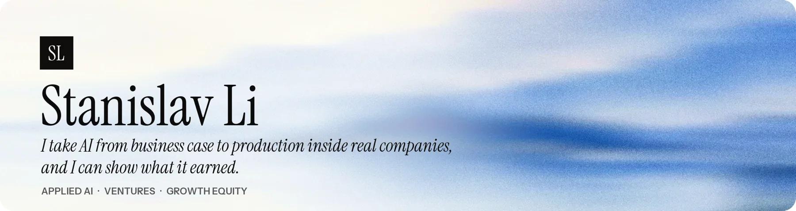
  </picture>
</a>

  
  
  
  

I work on enterprise AI deployment, operations and strategy, and invest in growth equity. I partner with businesses in manufacturing, logistics, finance and scientific research on 0 to 1 AI use cases, from building through deployment and adoption, and on launching new businesses.

Every project below starts with a business problem and ends with something running: in a plant, at a customer, or in a repo you can clone.

**Now:** Applied AI (Strategy) at Freshpet · co-founder of Yük (logistics) and Ragu (payments) · Lehigh, BS Computer Science and Business (Honors) and MS Applied Economics

 

## In industry

<table>
  <tr>
    <td width="50%" valign="top">
      <picture><source media="(prefers-color-scheme: dark)" srcset="assets/freshpet-cv-dark.webp">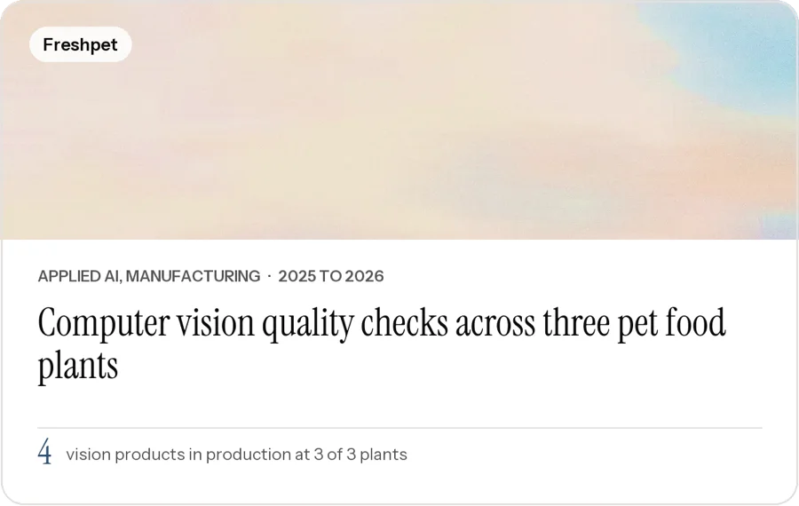</picture>
      Manual quality checks cost yield, labour and recall exposure. Took four vision products to production across all three plants, for $2M+ in projected savings.
    </td>
    <td width="50%" valign="top">
      <picture><source media="(prefers-color-scheme: dark)" srcset="assets/freshpet-ai-dark.webp">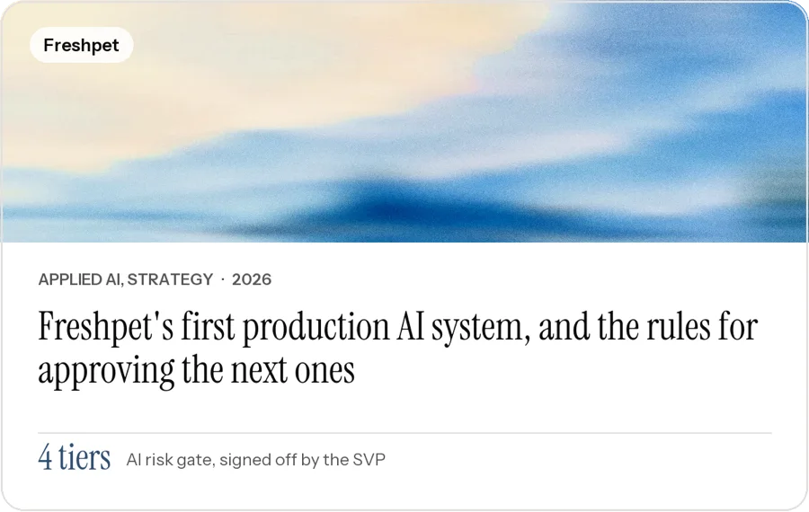</picture>
      Sales and marketing lost time hunting for research cleared for external use. Shipped an assistant that answers only from approved sources, and wrote the governance standard every AI use case now passes.
    </td>
  </tr>
  <tr>
    <td width="50%" valign="top">
      <a href="https://github.com/stanislavli3/did"><picture><source media="(prefers-color-scheme: dark)" srcset="assets/oracle-dark.webp">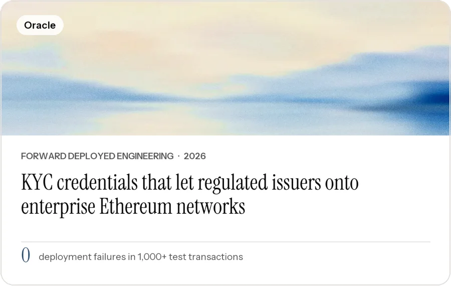</picture></a>
      Oracle-sponsored Lehigh engagement, embedded with Oracle engineers. Five identity verification modules on Hyperledger Besu. <a href="https://github.com/stanislavli3/did"><b>Repo</b></a>
    </td>
    <td width="50%" valign="top">
      <picture><source media="(prefers-color-scheme: dark)" srcset="assets/cv-lab-dark.webp">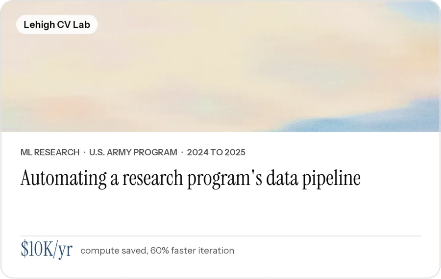</picture>
      Automated data processing for a U.S. Army research program, and studied how AI search ranks AI-generated images against real ones.
    </td>
  </tr>
</table>

## Ventures

<table>
  <tr>
    <td width="50%" valign="top">
      <picture><source media="(prefers-color-scheme: dark)" srcset="assets/yuk-dark.webp">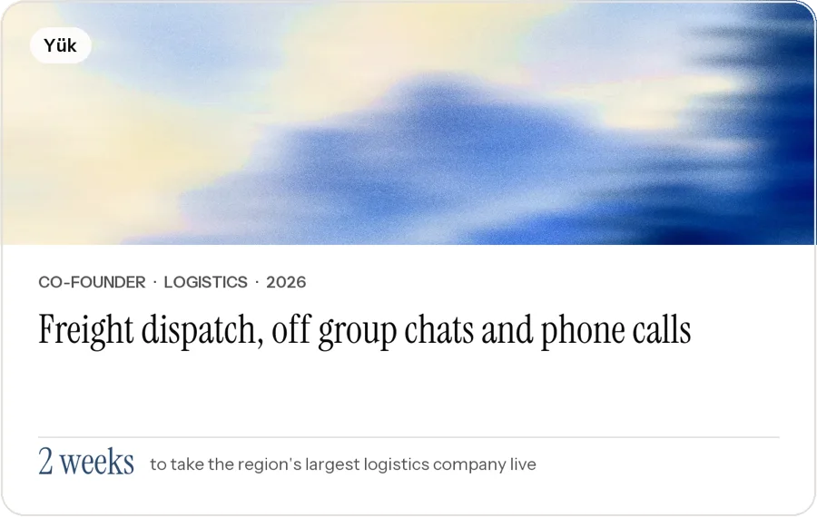</picture>
      Freight deals are made in Telegram and WhatsApp groups. Yük turns them into orders a company can run on: LLM extraction, an agent with typed tools, dispatch board and driver app.
    </td>
    <td width="50%" valign="top">
      <a href="https://ragu-payments.vercel.app"><picture><source media="(prefers-color-scheme: dark)" srcset="assets/ragu-dark.webp">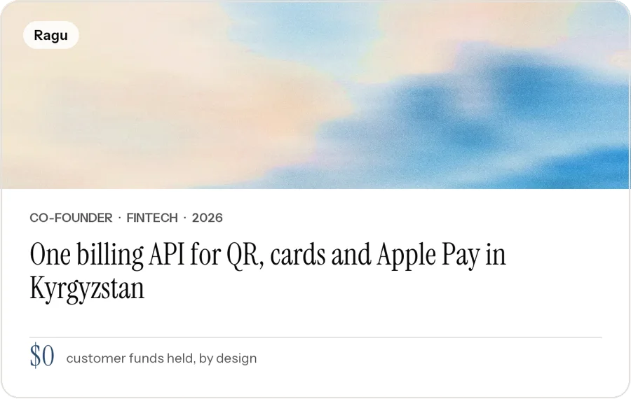</picture></a>
      Every bank and QR provider in Kyrgyzstan is its own integration. Sized a $63M market, built one API and checkout, and designed it to avoid a $343K licence capital requirement. <a href="https://ragu-payments.vercel.app"><b>Live</b></a>
    </td>
  </tr>
  <tr>
    <td width="50%" valign="top">
      <a href="https://github.com/stanislavli3/orbit"><picture><source media="(prefers-color-scheme: dark)" srcset="assets/orbit-dark.webp">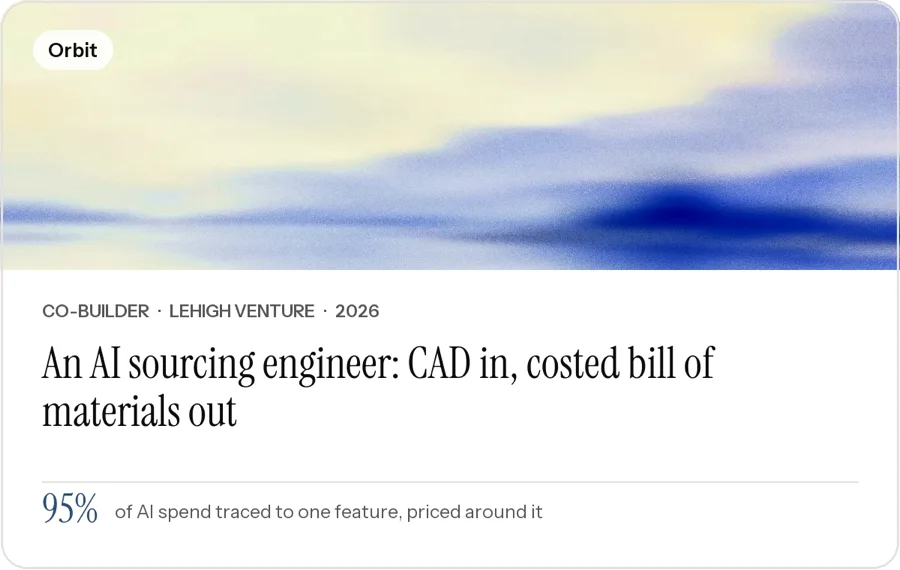</picture></a>
      Upload CAD; Orbit extracts the parts, finds suppliers, drafts the outreach and exports the workbook. Measured what every AI action costs before the first customer. <a href="https://github.com/stanislavli3/orbit"><b>Repo</b></a> · <a href="https://orbit-cloud-landing-84.vercel.app/"><b>Live</b></a>
    </td>
    <td width="50%" valign="top">
      <picture><source media="(prefers-color-scheme: dark)" srcset="assets/sani-dark.webp">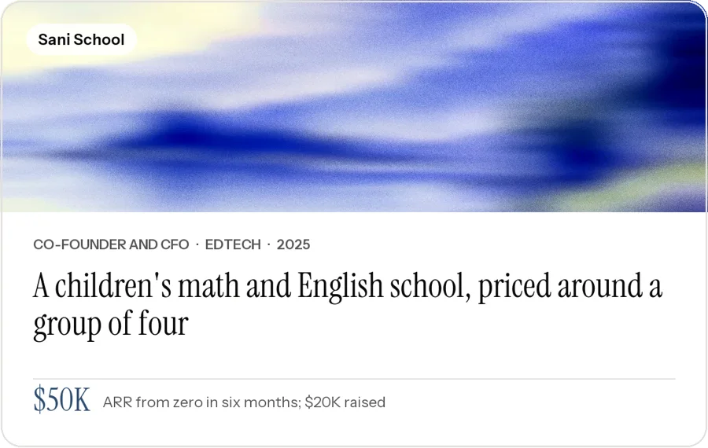</picture>
      An online math and English school for Kyrgyz children. Priced around a group of four, and built the clustering tool that fills each group with children at the same level.
    </td>
  </tr>
</table>

## Builds and research

<table>
  <tr>
    <td width="50%" valign="top">
      <a href="https://github.com/stanislavli3/rag-optimization-agent"><picture><source media="(prefers-color-scheme: dark)" srcset="assets/rag-dark.webp">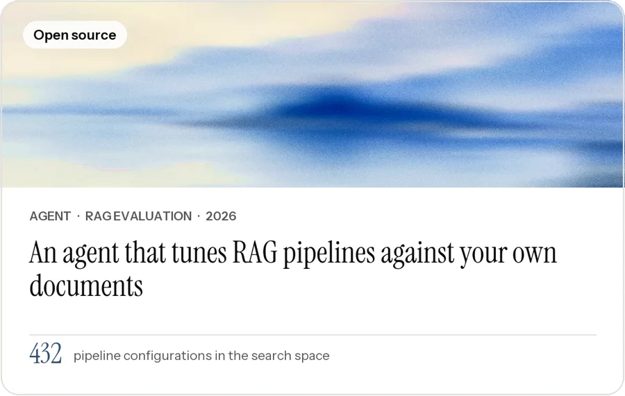</picture></a>
      Company AI assistants ship hand-tuned and untested. This agent builds a test set from your documents, then searches chunking, retrieval, reranking and prompts against RAGAS metrics. <a href="https://github.com/stanislavli3/rag-optimization-agent"><b>Repo</b></a> · <a href="https://rag-optimization-agent.vercel.app"><b>Live</b></a>
    </td>
    <td width="50%" valign="top">
      <a href="https://github.com/stanislavli3/mini-google-map"><picture><source media="(prefers-color-scheme: dark)" srcset="assets/minimap-dark.webp">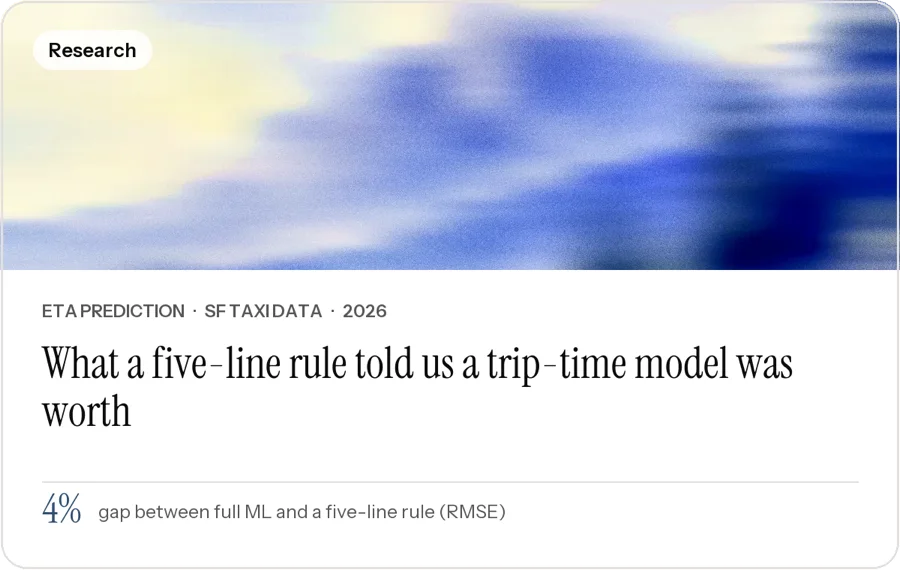</picture></a>
      HMM map matching and gradient boosting on San Francisco taxi GPS. The finding: five lines of arithmetic came within 4% of the full pipeline, so the effort moved to where it paid. <a href="https://github.com/stanislavli3/mini-google-map"><b>Repo</b></a>
    </td>
  </tr>
  <tr>
    <td width="50%" valign="top">
      <a href="https://github.com/stanislavli3/sputnik"><picture><source media="(prefers-color-scheme: dark)" srcset="assets/sputnik-dark.webp">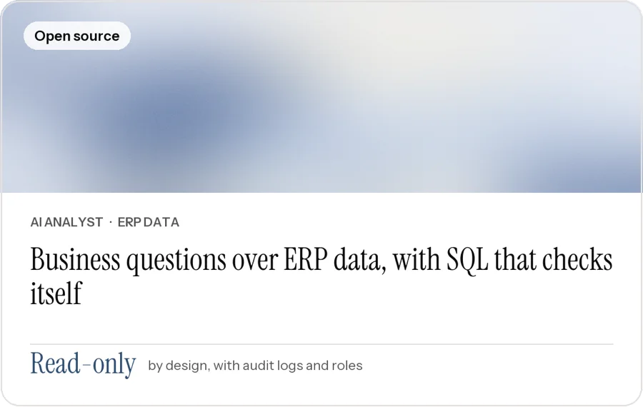</picture></a>
      Business teams wait on analysts for simple ERP questions. Sputnik answers in plain English, validates its own SQL, and runs read-only with audit logs and roles. <a href="https://github.com/stanislavli3/sputnik"><b>Repo</b></a>
    </td>
    <td width="50%" valign="top">
      <picture><source media="(prefers-color-scheme: dark)" srcset="assets/prodrinks-dark.webp">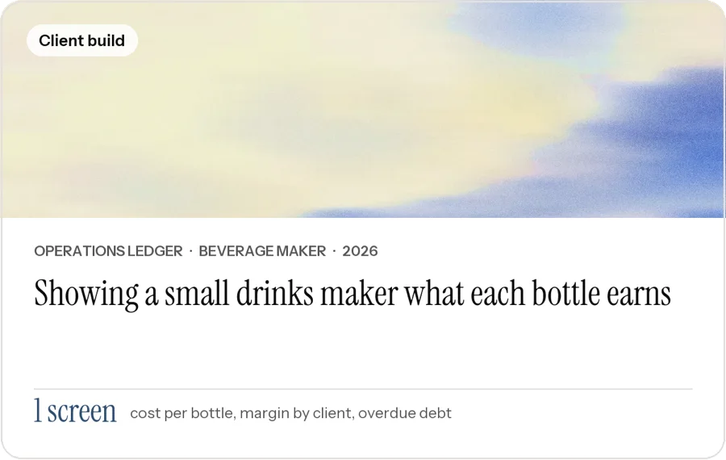</picture>
      A cold-brew maker ran stock, production and debts on paper and WhatsApp. Built a Russian-language ledger with accounting rules enforced in the database and a constrained Ask box.
    </td>
  </tr>
  <tr>
    <td width="50%" valign="top">
      <a href="https://github.com/stanislavli3/margins"><picture><source media="(prefers-color-scheme: dark)" srcset="assets/margins-dark.webp">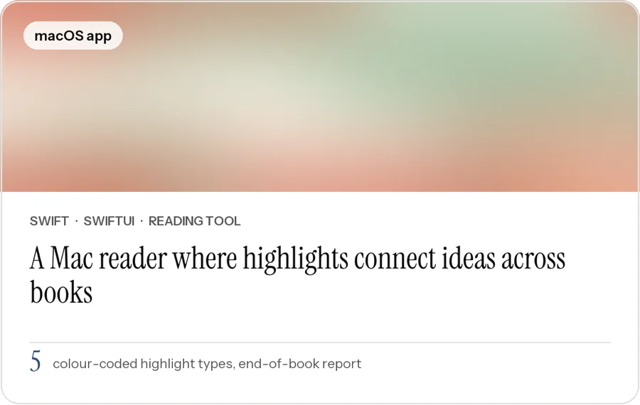</picture></a>
      A native macOS reader for EPUB and PDF: colour-coded highlights with notes, hashtag ideas that connect across books, and an end-of-book report. <a href="https://github.com/stanislavli3/margins"><b>Repo</b></a>
    </td>
    <td width="50%" valign="top">
      <a href="https://nawaprod.com/"><picture><source media="(prefers-color-scheme: dark)" srcset="assets/nawa-dark.webp">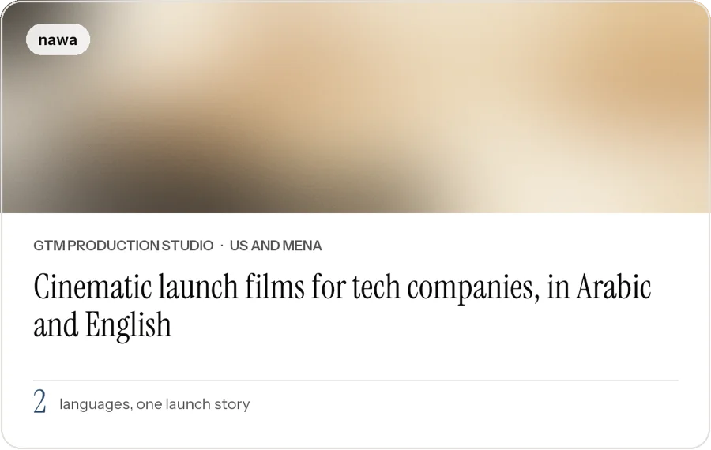</picture></a>
      A go-to-market production studio making launch films for tech companies across the US and MENA. <a href="https://nawaprod.com/"><b>nawaprod.com</b></a>
    </td>
  </tr>
</table>

<b>More from the workshop</b>

 

| Project | What it is | Stack |
|---|---|---|
| [Neural-Inspired Knowledge Database](https://github.com/stanislavli3/Neural-Inspired-Knowledge-Database) | Notes that connect themselves: graph neural networks and LLMs link related ideas | React, Django, graph ML |
| [MNIST Classification](https://github.com/stanislavli3/MNISTClassification) | A PyTorch classifier for handwritten digits, from the AI for Cyber-Physical Systems course | PyTorch, Jupyter |
| Soru.ai, LA Hacks 2024 | Turns handwritten notes and lecture videos into flashcards. Team hackathon build | OCR, Gemini |
| Muscle Intelligence | Colour-codes exercise form in real time. Team hackathon build | Pose estimation |

## Toolbox

  
  
  
  
  
   
  
  
  
  
  
  
  
   
  
  
  
  
  
  
  
  
  

## Path

| When | Where | What |
|---|---|---|
| 2026 to now | **Freshpet** (NASDAQ: FRPT) | Applied AI Intern, Strategy |
| 2025 to 2026 | **Freshpet** | Applied AI Intern, Manufacturing |
| 2026 | **Oracle** | Forward Deployed Engineer, Oracle-sponsored Lehigh engagement |
| 2025 | **Flashpoint VC** | Venture Scout: first-pass diligence on B2B AI deals |
| 2024 to 2025 | **Lehigh Computer Vision Lab** | Machine Learning Researcher |
| 2024 | **John Galt VC** | Investment Analyst Intern |

Also: English, Russian and developing Arabic; martial arts; a strong interest in Islamic finance.

If you're building something similar, or just want to talk, <a href="https://calendly.com/stl227/new-meeting">book a call</a>. Full case studies at <a href="https://www.stanislavli.xyz/">stanislavli.xyz</a>.

